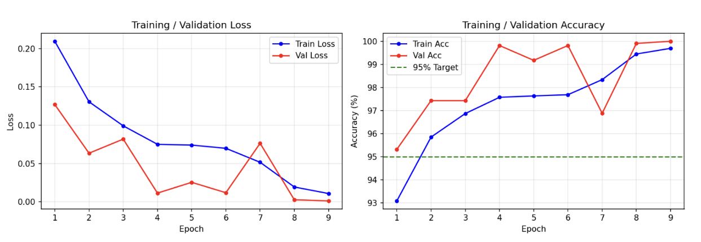
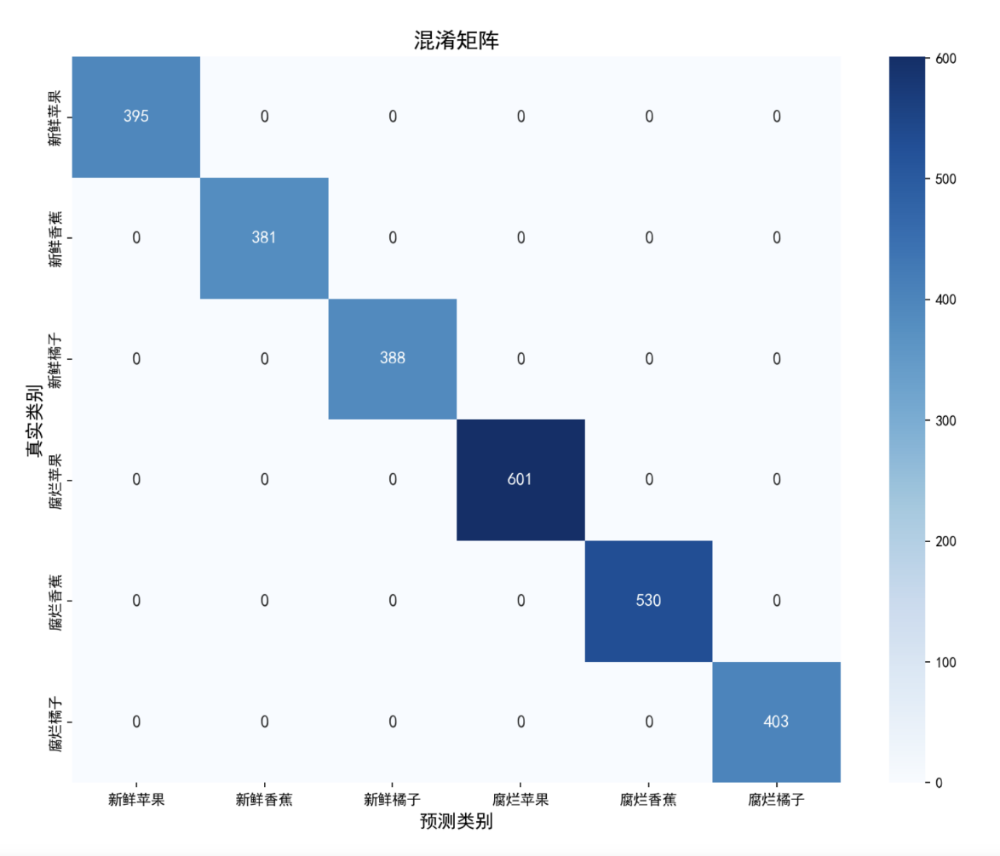
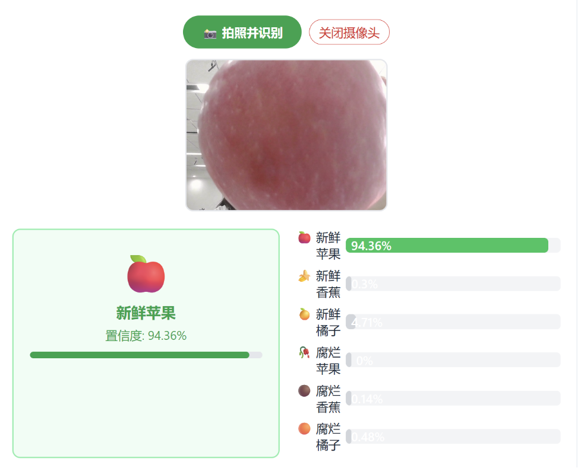

# 基于迁移学习的水果新鲜度智能分类系统

> 深度学习课程设计项目 · MobileNetV2 + Flask 全流程实现
> 测试集准确率 100% · CPU 实时推理 · 前后端分离部署

---

## 一、项目介绍

在水果生产、仓储、零售等环节中，水果新鲜度的检测长期依赖人工分拣，效率低、成本高且易因视觉疲劳导致误判。随着深度学习在计算机视觉领域的发展，利用卷积神经网络实现自动化水果新鲜度检测已成为解决这一痛点的有效方案。

本项目基于迁移学习技术，实现了一个能够自动识别6类水果新鲜度状态的智能分类 Web 应用系统。用户通过网页上传图片或调用摄像头拍照，即可即时得到分类结果与置信度反馈。系统在普通笔记本 CPU 环境下即可流畅运行，便于实际部署。


---

## 二、技术栈

| 类别 | 技术选型 |
|---|---|
| 深度学习框架 | PyTorch 2.11.0 (CPU版) |
| 基础模型 | MobileNetV2（迁移学习，ImageNet预训练） |
| 后端 | Python + Flask |
| 前端 | 原生 HTML / CSS / JavaScript |
| 模型部署 | ONNX 格式导出 + ONNX Runtime |
| 数据集 | Kaggle: Fruits Fresh and Rotten for Classification |

---

## 三、数据集

### 3.1 数据集来源
采用 Kaggle 公开数据集 *Fruits Fresh and Rotten for Classification*，共包含 6 个类别：

| 类别 | 训练集 | 测试集 |
|---|---:|---:|
| 新鲜苹果 | 1693 | 395 |
| 新鲜香蕉 | 1581 | 381 |
| 新鲜橘子 | 1466 | 388 |
| 腐烂苹果 | 2342 | 601 |
| 腐烂香蕉 | 2224 | 530 |
| 腐烂橘子 | 1595 | 403 |
| **合计** | **10901** | **2698** |

### 3.2 数据预处理
- 图像统一缩放为 224×224，匹配 MobileNetV2 输入尺寸
- 使用 ImageNet 均值与标准差进行归一化（mean=[0.485, 0.456, 0.406]，std=[0.229, 0.224, 0.225]）
- **数据增强**（仅训练集启用）：
  - 随机水平翻转（p=0.5）：模拟水果不同摆放方向
  - 随机旋转（±15°）：应对拍摄角度差异
  - 颜色抖动（亮度/对比度/饱和度0.2）：模拟不同光照条件
  - 高斯模糊（kernel=3）：提升对模糊样本的鲁棒性
- Batch Size = 32，训练集打乱，验证/测试集固定顺序

---

## 四、模型设计

### 4.1 为什么选 MobileNetV2？
- **精度足够**：在 ImageNet 上预训练，特征提取能力强
- **轻量化**：参数量仅约 3.5M，远小于 ResNet/VGG 等大模型
- **推理快**：CPU 环境下单张图片毫秒级响应，适合 Web 部署

### 4.2 模型结构
采用迁移学习策略，保留 MobileNetV2 特征提取层，仅替换最后的分类头：

```
输入: [N, 3, 224, 224]
  ↓
MobileNetV2 主干（17个倒残差块）→ 输出 1280 维特征向量
  ↓
Dropout(0.2)  # 防止过拟合
  ↓
全连接层: 1280 → 6
  ↓
输出: [N, 6]  # 6类水果的logits
```

### 4.3 改进点
1. **组合数据增强策略**：同时使用翻转、旋转、颜色抖动、高斯模糊，模拟真实拍摄环境
2. **Dropout + 权重衰减双重正则化**：有效抑制过拟合，提升泛化能力
3. **学习率衰减**：每7轮学习率降为1/10，前期快速收敛、后期精细微调
4. **保存验证集最优模型**：以验证集准确率为标准保存最优权重，避免过拟合

---

## 五、训练与结果

### 5.1 训练环境
- 硬件：Intel Core Ultra 5 125H / 24GB RAM / CPU（无独立GPU）
- 训练耗时：约 4~5 小时
- 提前停止：第9轮验证集准确率达 100%，手动终止（原计划15轮）

### 5.2 训练过程曲线


### 5.3 最终精度

| 指标 | 结果 |
|---|---:|
| 测试集准确率 | **100.00%** |
| 精确率（Precision） | 100% |
| 召回率（Recall） | 100% |
| F1 分数 | 1.0 |
| 模型参数量 | 约 3.5M |

### 5.4 混淆矩阵


> 注：100% 准确率得益于迁移学习的强特征提取能力，以及该数据集新鲜/腐烂样本视觉区分度较高。真实场景下复杂光照、轻微腐烂等边界情况仍有提升空间。

---

## 六、Web 应用

### 6.1 系统架构
前后端分离架构：
- **后端**（Flask）：加载模型、提供 RESTful API、处理图片推理
- **前端**（HTML）：上传/拍照、展示识别结果、置信度可视化
- **模型单例加载**：服务启动时加载一次，后续请求复用

### 6.2 功能模块
- 📷 **单张识别**：拖拽/点击上传图片
- 📁 **批量识别**：多文件批量上传
- 📸 **拍照识别**：调用浏览器摄像头实时拍照
- 📊 **结果展示**：类别标签、置信度百分比、各类别概率柱状图
- 🕐 **历史记录**：记录最近识别结果

### 6.3 识别效果示例


---

## 七、运行方式

```bash
# 1. 安装依赖
pip install -r requirements.txt

# 2. 启动后端服务
python backend.py

# 3. 浏览器访问
# 打开 http://127.0.0.1:5000
```

---

## 八、目录结构

```
fruit-freshness-recognition/
├── train.py           # 模型训练脚本
├── evaluate.py        # 模型评估与指标计算
├── dataset.py         # 自定义数据集类
├── export_onnx.py    # 模型导出为ONNX格式
├── backend.py         # Flask Web 后端
├── requirements.txt   # Python 依赖清单
├── README.md          # 项目说明
└── templates/         # 前端页面模板
```

---

## 九、项目总结

本项目完整实现了一个深度学习项目的全流程：
1. 数据集构建与预处理 → 自定义 Dataset + 组合数据增强
2. 模型设计与训练 → MobileNetV2 迁移学习 + 多重正则化策略
3. 模型评估与优化 → 测试集准确率 100%，混淆矩阵与分类指标分析
4. Web 部署 → Flask 前后端分离，支持上传与拍照识别
